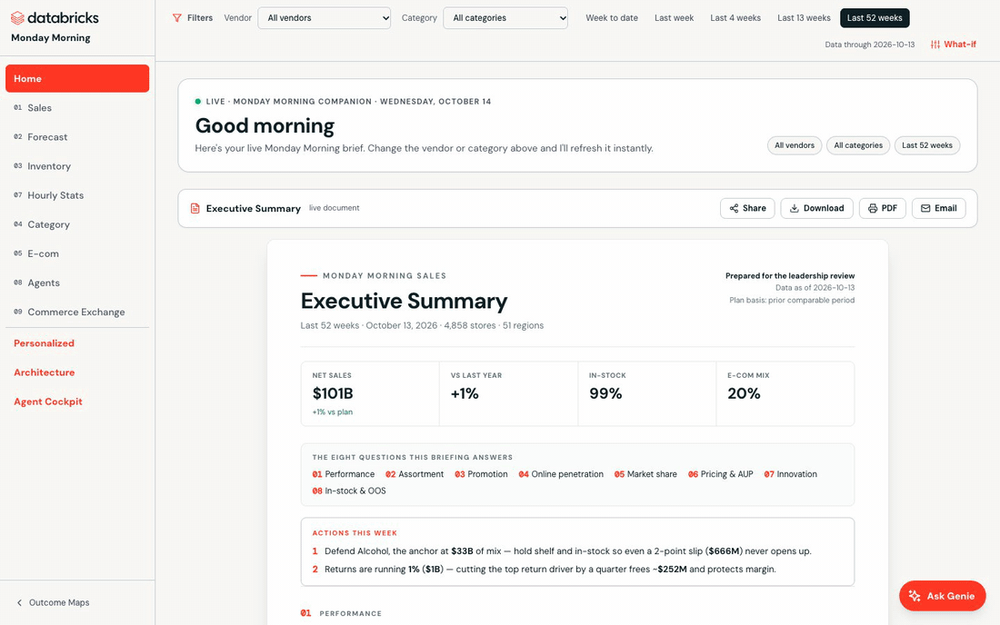

# Deploy Monday Morning on Scintilla

Monday Morning is a retail-intelligence Databricks App built on Walmart Scintilla Cloud Feeds: a live executive brief, then sales, forecast, inventory, hourly, category, e-commerce, agents and commerce-exchange views, each with Ask Genie.

This skill checks permissions, inventories the licensed feeds, and deploys the locked golden App against a pre-provisioned Databricks footprint. Agent instructions are in [SKILL.md](SKILL.md); the App contract is in [references/app-contract.md](references/app-contract.md).
